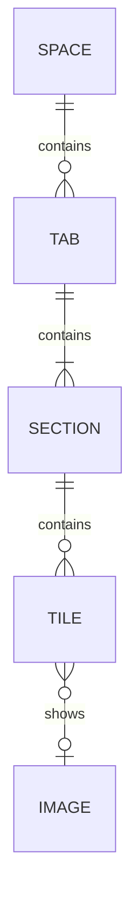
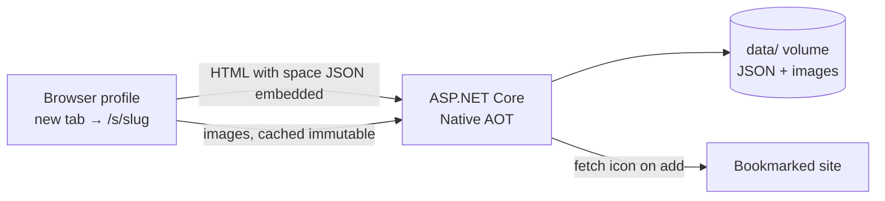

# Bookmarks — spec

A self-hosted start page for bookmarks, split into **spaces** so each browser profile shows only its own
subset. It replaces a Speed Dial 2 setup: its tab/tile model, plus spaces above and optional sections within a tab, and without the
features that went unused.

## Goals

- **Fast.** The page opens on every new tab. One small HTML response, images from cache, no framework.
- **Maintainable from anywhere.** Add, edit, reorder and move tiles from any device that can reach the server.
- **One space per browser profile.** A personal profile, a work profile and a customer profile each open their
  own space by URL.
- **Self-contained.** The server stores every image itself; the page never loads from a third party.

## Non-goals

- Visit counters, time-of-day statistics, launcher, sidebar, browser-bookmark sync.
- Page screenshots as thumbnails.
- One tile shared across spaces. A tile needed in two spaces is duplicated.
- Multiple users, accounts or sharing.
- A browser extension of our own. The new tab is pointed at a space URL with an existing
  "custom new tab URL" extension (see [Open questions](#open-questions)).

## Model



| Entity | Fields | Notes |
|---|---|---|
| Space | `slug`, `name`, `version`, `tabs[]` | One JSON file per space. `slug` is the URL segment. One per browser profile. |
| Tab | `id`, `title`, `sections[]` | One tab visible at a time. |
| Section | `id`, `title`, `tiles[]` | A titled block of tiles within a tab. `title` may be `null`. |
| Tile | `id`, `title`, `url`, `image` | `image` is an image reference or `null`. |
| Image | content hash + extension | Stored once, shared by any tile that references it. |

**Sections are optional in practice.** Every tab has at least one section, but a tab whose only section has no
title renders as a plain grid of tiles, with no heading. A small tab stays flat; a large one can be split into
titled sections without changing anything else.

**Order is array order.** Tabs, sections and tiles are stored in display order; there is no `position` field.
Reordering, or moving a tile to another section, tab or space, saves the affected arrays.

Example `data/spaces/personal.json`:

```json
{
  "slug": "personal",
  "name": "Personal",
  "version": 42,
  "tabs": [
    {
      "id": "b_7k2m",
      "title": "Home",
      "sections": [
        {
          "id": "s_4hd0",
          "title": null,
          "tiles": [
            { "id": "t_9xq1", "title": "Example", "url": "https://example.com/", "image": "3f2a…c1.png" }
          ]
        }
      ]
    }
  ]
}
```

## Storage

JSON files on disk, not a database. The access pattern is "read a whole space, write a whole space"; a few
hundred tiles per space is well under a megabyte. SQLite would add a dependency, a backup hook and friction
with Native AOT without buying anything at this size. Revisit if edit history, multiple users or cross-space
queries become requirements; migrating is a one-off import.

```
data/
  spaces.json            # space order and names
  spaces/<slug>.json     # one file per space
  images/<sha256>.<ext>  # content-addressed, immutable
```

- **Atomic writes:** write to a temp file in the same folder, then rename over the original.
- **Optimistic concurrency:** each space carries a `version`. A save sends the version it was based on; a
  mismatch is rejected with `409 Conflict` so two devices cannot silently overwrite each other.
- `data/` is a mounted volume, never committed, and is what the backup covers.

## Architecture



- **Backend:** ASP.NET Core minimal API on .NET 10, published with Native AOT. Single small binary, fast
  start, low memory. `System.Text.Json` with source generation.
- **Frontend:** plain TypeScript, built with Vite, no UI framework. Served as static files by the backend.
- **Deploy:** one Docker image, `data/` as a volume.
- **Access:** the server is reachable only on a private network (e.g. a Tailscale tailnet, with
  `tailscale serve` providing HTTPS). There is no login in the app; network access is the authorisation.
  Deployment specifics live outside this repo.

### Endpoints

| Method | Path | Purpose |
|---|---|---|
| `GET` | `/` | Redirect to the first space. |
| `GET` | `/s/{slug}` | The start page, with the space JSON embedded in the HTML — no second request. |
| `GET` | `/api/spaces` | Space list (slug, name, order). |
| `GET` | `/api/spaces/{slug}` | One space. |
| `PUT` | `/api/spaces/{slug}` | Save a space; requires the base `version`, `409` when stale. |
| `POST` | `/api/spaces` · `DELETE` `/api/spaces/{slug}` | Create / remove a space. |
| `POST` | `/api/icons` | Fetch the best icon and the page title for a URL; store the icon, return both. |
| `POST` | `/api/images` | Upload or paste a custom image (raw body, max 1 MB), store it, return the image reference. |
| `GET` | `/img/{hash}.{ext}` | Serve an image, cached as immutable, with `nosniff` and a sandboxing CSP so an SVG opened directly cannot run script. |

## Images

Every image is stored on the server, never hot-linked. This also keeps third parties from learning what is
bookmarked.

- **On add**, the server reads the page and collects candidates from `<link rel="icon">`,
  `apple-touch-icon`, the web app manifest (skipping maskable/monochrome icons) and `/favicon.ico`. An SVG
  wins, then the largest bitmap; the first candidate that downloads as a real image is kept. The page title
  is returned too and fills an empty tile title. If nothing usable is found the tile shows a letter tile.
- The image format is sniffed from the bytes (PNG, JPEG, GIF, WebP, ICO, SVG); file names and Content-Type
  headers are not trusted.
- **Custom image** per tile, by upload or paste, overrides the fetched one. This is how several tiles for the
  same site are told apart.
- **Re-fetch** on demand per tile.
- Images are content-addressed (`sha256`), so the same icon used by many tiles is stored once. Unreferenced
  images can be swept.

The icon fetch is server-side request handling of arbitrary URLs. Guard it: `http`/`https` only, a short
timeout, a response size cap, and an image content-type check. Fetching LAN addresses is allowed on purpose
(intranet bookmarks), which is acceptable only because the server is not publicly reachable.

## Start page

- The space name, top left, is also the space switcher. The other spaces are listed only when it is opened,
  so they stay out of sight while sharing a screen with one customer.
- Tabs sit next to it; the active tab is kept in the URL hash.

## Editing

- An **Edit** button switches the page into edit mode; outside it, the page is a plain start page.
- Add, edit and delete tabs, sections and tiles inline on the start page. In edit mode, clicking a tile opens
  its dialog (URL, title, image, move/copy, delete); clicking the active tab renames it.
- Drag and drop to reorder tiles, move them between sections, and reorder sections and tabs. Dropping a tile
  on a tab moves it to that tab's first section.
- Move or copy a tile to another space.
- Saves go through `PUT /api/spaces/{slug}`; on `409` the page reloads the space and tells the user.
  Changes apply locally at once and are saved in the background; rapid edits coalesce into one save.
- Space rename, create and delete live in the space switcher, in edit mode only.

## Import from Speed Dial 2

A one-off import of a Speed Dial 2 JSON export (`dials[]`, `groups[]`, `preferences`):

- Takes a mapping of Speed Dial groups to spaces; unmapped groups go to a default space.
- Each Speed Dial group becomes a tab with one untitled section. Splitting into sections is done afterwards
  in the app.
- Keeps group and tile order from the export's `position` fields.
- Keeps `title` and `url`. Drops visit counters, timestamps and preferences.
- **Ignores the exported thumbnails.** They are page screenshots or links to hosts that are gone or will go.
  Every imported tile gets a freshly fetched icon instead.
- The export file is read from outside the repo and is never committed.

## Open questions

- Which "custom new tab URL" extension for Edge to use — chosen on security: minimal permissions, open source,
  maintained.
